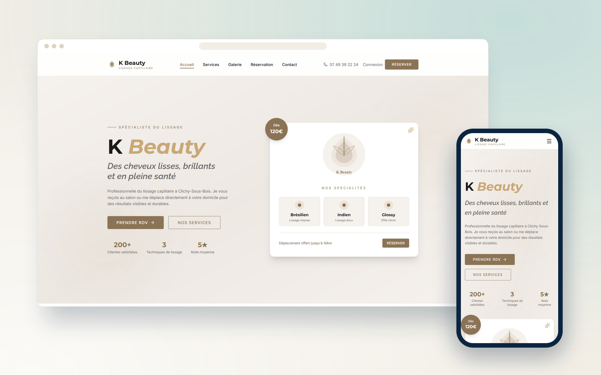
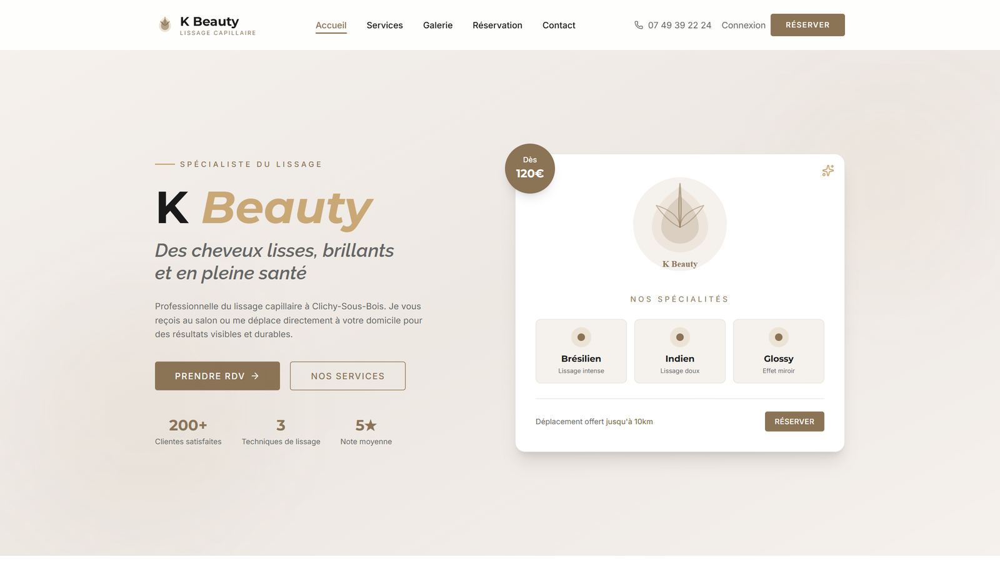
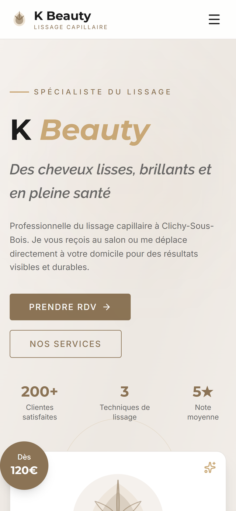
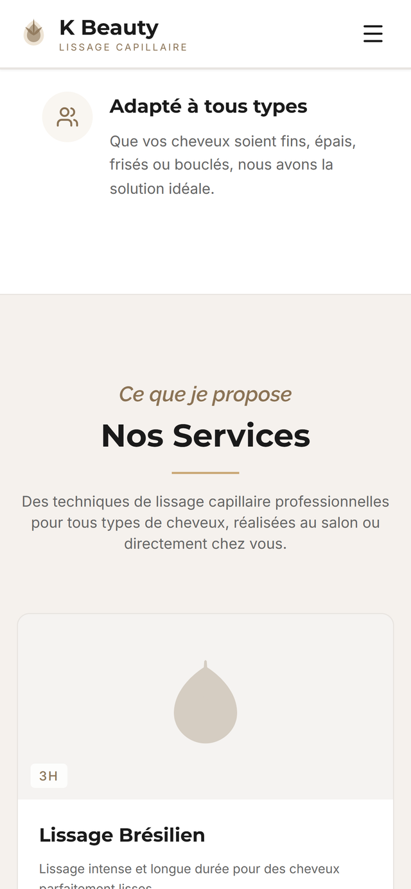
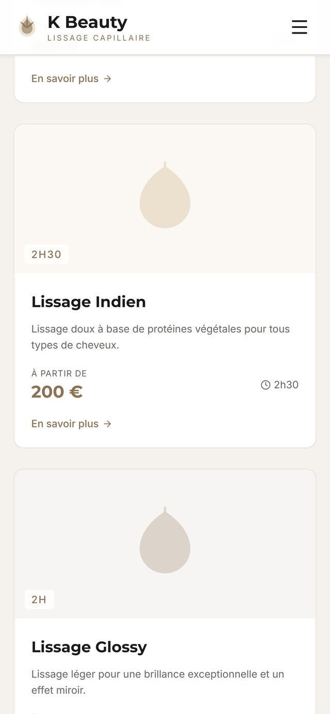

  

<h1 align="center">K Beauty Hair Salon</h1>

  <b>Site de salon de coiffure avec réservation de créneaux en ligne et paiement sécurisé.</b>
   
  Hair salon website with online slot booking and secure payment.

  

  
  
  

---

## Le projet

Un site vitrine élégant doublé d'un moteur de réservation : les clientes choisissent la prestation, voient les créneaux réellement disponibles et confirment leur rendez-vous en payant en ligne. Le salon gère ses horaires, ses prestations et son planning depuis une interface d'administration dédiée.

## Fonctionnalités

- Réservation en ligne avec créneaux calculés selon la durée de la prestation
- Paiement sécurisé par Stripe (acompte ou prestation complète)
- Catalogue de prestations avec durées et tarifs
- Interface d’administration des rendez-vous et des horaires d’ouverture
- Rendu serveur Next.js pour un chargement rapide et un bon référencement

## Aperçu

### Ordinateur

### Mobile

  
  
  

## Fiche

| | |
|---|---|
| **Type** | Site web |
| **Contexte** | Projet client · Clichy-sous-Bois |
| **Année** | 2026 |
| **Rôle** | Conception et développement complets (design, front-end, back-end, mise en ligne) |
| **Technologies** | Next.js · Supabase · Stripe |
| **Site** | non public |

## Code source

> [!NOTE]
> Le code source de ce projet client est privé. Ce dépôt est une vitrine : il présente le projet, ses fonctionnalités et des captures.
> Pour en discuter ou pour un projet similaire : [portfolio](https://satouri-dev.vercel.app/fr) · [LinkedIn](https://www.linkedin.com/in/abdel-monaam-satouri-054268314).

---

  Conçu et développé par <a href="https://satouri-dev.vercel.app/fr">Satouri Développement</a> · Djerba, Tunisie
   
  © 2026 Abdelmonaam Satouri — Tous droits réservés

